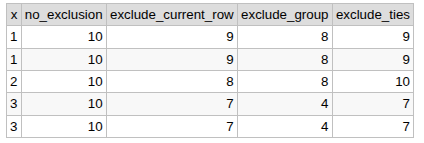

# https://dbfiddle.uk/CN5mIf

# https://www.postgresql.org/docs/current/sql-expressions.html#SYNTAX-WINDOW-FUNCTIONS

# 5. Window Frames

## where frame_start and frame_end can be one of
```sql 
ROWS BETWEEN UNBOUNDED PRECEDING AND CURRENT ROW
ROWS BETWEEN 1 PRECEDING AND CURRENT ROW
ROWS BETWEEN 2 PRECEDING AND CURRENT ROW
ROWS BETWEEN CURRENT ROW AND UNBOUNDED FOLLOWING
ROWS BETWEEN CURRENT ROW AND 2 FOLLOWING

offset PRECEDING = n previous rows  <--
offset FOLLOWING = n following rows -->
CURRENT ROW = current row
UNBOUNDED PRECEDING = 0  (of partition)
UNBOUNDED FOLLOWING = N-1 (end of partition)


EXCLUDE CURRENT ROW - Excludes the current row
EXCLUDE GROUP - Excludes the current row and all its peers.
EXCLUDE TIES - Excludes all peers of the current row, but keeps the current row.
```

## The optional frame_clause can be one of

{ RANGE | ROWS | GROUPS }


## ROWS
```sql 
SELECT
    title,
    year,
    SUM(year) OVER (
        ORDER BY year, title
        ROWS BETWEEN CURRENT ROW AND 2 FOLLOWING
    ) AS total
FROM movies;
```
| **title** | **year** | **total** |
| :--- | ---: | ---: |
| **Up** | **2010** | **6060** |
| **Cars** | **2020** | **6090** |
| **Brave** | **2030** | **6120** |
| **Brave** | **2040** | **4090** |
| **WALL-E** | **2050** | **2050** |


## RANGE 

RANGE: distance between values. Ex. 2005–2006

Attention: With RANGE, rows with the same ORDER BY values (peers) have the same result because they share the same window frame.
RANGE

```sql 
SELECT
    title,
    year,
    category,
    SUM(year) OVER (
        ORDER BY year
        RANGE BETWEEN 1 PRECEDING AND CURRENT ROW
    ) AS total
FROM movies;
```
| **title** | **year** | **category** | **total** |
| :--- | ---: | :--- | ---: |
| **Up** | **2005** | **Animation** | **2005** |
| **Cars** | **2006** | **Animation** | **4011** |
| **Brave** | **2010** | **Adventure** | **2010** |
| **Brave** | **2015** | **Adventure** | **2015** |
| **Brave** | **2016** | **Adventure** | **4031** |
| **Brave** | **2019** | **Adventure** | **6057** |
| **Brave** | **2019** | **Adventure** | **6057** |
| **WALL-E** | **2019** | **Adventure** | **6057** |


## GROUPS
```sql 
SELECT
    title,
    year,
    category,
    SUM(year) OVER (
        ORDER BY year
        GROUPS BETWEEN 1 PRECEDING AND CURRENT ROW
    ) AS total
FROM movies;
```
| **title** | **year** | **category** | **total** |
| :--- | ---: | :--- | ---: |
| **Up** | **2005** | **Animation** | **2005** |
| **Cars** | **2006** | **Animation** | **4011** |
| **Brave** | **2010** | **Adventure** | **4016** |
| **Brave** | **2015** | **Adventure** | **4025** |
| **Brave** | **2016** | **Adventure** | **4031** |
| **Brave** | **2019** | **Adventure** | **8073** |
| **Brave** | **2019** | **Adventure** | **8073** |
| **WALL-E** | **2019** | **Adventure** | **8073** |


# WITH OVER ( )

```sql 
SELECT
    title,
    year,
    SUM(year) OVER (
        PARTITION BY category
        ORDER BY year
    ) AS total,
    AVG(year) OVER (
        PARTITION BY category
        ORDER BY year
    ) AS average,
    COUNT(*) OVER (
        PARTITION BY category
        ORDER BY year
    ) AS movie_count
FROM movies;
```
# with  WINDOW
```sql 
SELECT
    title,
    year,
    SUM(year) OVER w AS total,
    AVG(year) OVER w AS average,
    COUNT(*) OVER w AS movie_count
FROM movies
WINDOW w AS (
    PARTITION BY category
    ORDER BY year
);
```
```sql
SELECT
    title,
    year,
    category,
    SUM(year) OVER w1 AS category_total,
    ROW_NUMBER() OVER w2 AS row_num
FROM movies
WINDOW
    w1 AS (
        PARTITION BY category
    ),
    w2 AS (
        PARTITION BY category
        ORDER BY year
    );
```

# EXCLUDE options

```sql
SELECT
    x,
    SUM(x) OVER (
        ORDER BY x
        GROUPS BETWEEN UNBOUNDED PRECEDING AND UNBOUNDED FOLLOWING
    ) AS no_exclusion,
    SUM(x) OVER (
        ORDER BY x
        GROUPS BETWEEN UNBOUNDED PRECEDING AND UNBOUNDED FOLLOWING
        EXCLUDE CURRENT ROW
    ) AS exclude_current_row,
    SUM(x) OVER (
        ORDER BY x
        GROUPS BETWEEN UNBOUNDED PRECEDING AND UNBOUNDED FOLLOWING
        EXCLUDE GROUP
    ) AS exclude_group,
    SUM(x) OVER (
        ORDER BY x
        GROUPS BETWEEN UNBOUNDED PRECEDING AND UNBOUNDED FOLLOWING
        EXCLUDE TIES
    ) AS exclude_ties
FROM (
    VALUES (1), (1), (2), (3), (3)
) AS numbers(x)
ORDER BY x;
```
