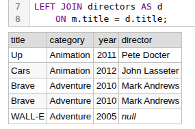

# JOIN

```sql
SELECT
    m.title,
    m.category,
    m.year,
    d.director
FROM movies AS m
LEFT JOIN directors AS d
    ON m.title = d.title;
```



## INNER JOIN – Returns only matching rows from both tables.
## LEFT JOIN – Returns all rows from the left table and matching rows from the right table.
## RIGHT JOIN – Returns all rows from the right table and matching rows from the left table.
## FULL OUTER JOIN – Returns all rows from both tables, matching them where possible and filling unmatched columns with NULL.

# CROSS JOIN – Returns the Cartesian product of two tables, generating every possible combination of their rows.
```sql
SELECT
    p.product,
    s.size
FROM products AS p
CROSS JOIN sizes AS s;
```

# SELF JOIN – Joins a table with itself to compare rows within the same table.
```sql
SELECT
    m1.title AS movie1,
    m2.title AS movie2,
    m1.category
FROM movies AS m1
INNER JOIN movies AS m2
    ON m1.category = m2.category
   AND m1.title < m2.title;
```

#  JOIN with three tables 
```sql
SELECT
    m.title,
    m.category,
    d.director,
    s.studio
FROM movies AS m
INNER JOIN directors AS d
    ON m.title = d.title
INNER JOIN studios AS s
    ON m.title = s.title;
```

# USING (..) joins tables using a column with the same name in both tables.
```sql
SELECT
    title,
    category,
    director
FROM movies
INNER JOIN directors
    USING (title,year);
```

# DISTINCT returns unique rows by removing duplicate combinations of selected column values.

```sql
SELECT DISTINCT m.title, d.director
FROM movies AS m
INNER JOIN directors AS d
    ON m.title = d.title;
```
```sql
SELECT DISTINCT m.title
FROM movies AS m;
```

# Subquery

# WHERE IN
```sql
SELECT title, category
FROM movies
WHERE category IN (
    SELECT category
    FROM movies
    WHERE year = 2010
);
```

# WHERE  =
```sql
SELECT title, year
FROM movies
WHERE year > (
    SELECT AVG(year)
    FROM movies
);
```

# MAX()
```sql
SELECT title, year
FROM movies
WHERE year = (
    SELECT MAX(year)
    FROM movies
);
```

# EXISTS
```sql
SELECT m.title, m.category
FROM movies AS m
WHERE EXISTS (
    SELECT 1
    FROM directors AS d
    WHERE d.title = m.title
);
```

# NOT EXISTS
```sql
SELECT m.title
FROM movies AS m
WHERE NOT EXISTS (
    SELECT 1
    FROM directors AS d
    WHERE d.title = m.title
);
```

# SELECT
```sql
SELECT
    title,
    year,
    (SELECT COUNT(*) FROM movies) AS total_movies
FROM movies;
```

# FROM
```sql
SELECT category, movie_count
FROM (
    SELECT
        category,
        COUNT(*) AS movie_count
    FROM movies
    GROUP BY category
) AS category_stats
WHERE movie_count > 1;
```

# Correlated Subquery
```sql
SELECT m1.title, m1.category, m1.year
FROM movies AS m1
WHERE m1.year > (
    SELECT AVG(m2.year)
    FROM movies AS m2
    WHERE m2.category = m1.category
);
```

# HAVING filters groups based on a condition, usually after GROUP BY. 
```sql
SELECT
    category,
    COUNT(*) AS movie_count
FROM movies
GROUP BY category
HAVING COUNT(*) > 1;
```
| category | movie_count |
|---|---:|
| Animation | 2 |
| Adventure | 3 |


| Operator | Meaning |
| -------- | ------- |
| `> ANY`  | Greater than at least one value |
| `> ALL`  | Greater than all values |
| `< ANY`  | Less than at least one value |
| `< ALL`  | Less than all values |
| `= ANY`  | Equal to at least one value |
| `= ALL`  | Equal to all values |

- SOME → Equivalent to ANY.
```sql
SELECT title, year
FROM movies
WHERE year > ANY (
    SELECT year
    FROM movies
    WHERE category = 'Adventure'
);
```