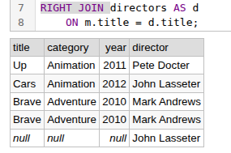
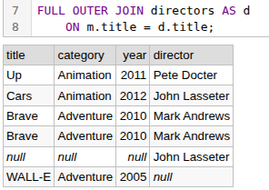

# JOIN

```sql
SELECT
    m.title,
    m.category,
    m.year,
    d.director
FROM movies AS m
LEFT JOIN directors AS d
    ON m.title = d.title;
```




## INNER JOIN – Returns only matching rows from both tables.
## LEFT JOIN – Returns all rows from the left table and matching rows from the right table.
## RIGHT JOIN – Returns all rows from the right table and matching rows from the left table.
## FULL OUTER JOIN – Returns all rows from both tables, matching them where possible and filling unmatched columns with NULL.

# CROSS JOIN – Returns the Cartesian product of two tables, generating every possible combination of their rows.
```sql
SELECT
    p.product,
    s.size
FROM products AS p
CROSS JOIN sizes AS s;
```

# SELF JOIN – Joins a table with itself to compare rows within the same table.
```sql
SELECT
    m1.title AS movie1,
    m2.title AS movie2,
    m1.category
FROM movies AS m1
INNER JOIN movies AS m2
    ON m1.category = m2.category
   AND m1.title < m2.title;
```

#  JOIN with three tables 
```sql
SELECT
    m.title,
    m.category,
    d.director,
    s.studio
FROM movies AS m
INNER JOIN directors AS d
    ON m.title = d.title
INNER JOIN studios AS s
    ON m.title = s.title;
```
